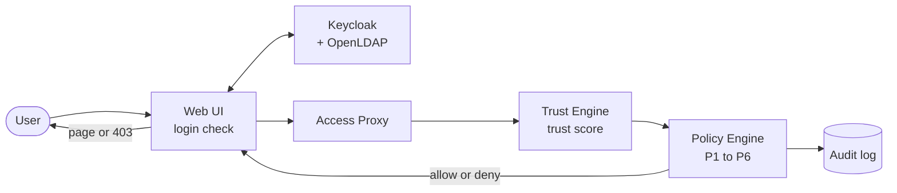

# CyberDome: a Zero Trust Access-Control Prototype

CyberDome is a local Zero Trust access-control prototype. Every request for a protected resource follows the Zero Trust workflow:

```text
User -> Authentication -> Access Proxy -> Trust Evaluation -> Policy Evaluation -> Allow/Deny -> Resource -> Logging
```

- **Authentication:** users log in through Keycloak (OIDC), with identities and groups in OpenLDAP. Every page checks that the login token is still active.
- **Access Proxy:** every protected page sends its request through the Access Proxy, also when it's opened directly by URL. The page only runs after an "allow".
- **Trust Engine:** scores each request between 0 and 1 from 7 weighted factors: login history, device, access frequency, location, identity strength, time of access and account age.
- **Policy Engine:** six named policies (P1 to P6) decide, using the user's role and the request context. Every decision says which policy decided and why.
- **Audit log:** every decision is logged with the categories `ALLOW`, `DENY`, `AUTHENTICATION_FAILURE` and `POLICY_VIOLATION`, and shown on the `/logging` page.

CyberDome started as an existing project. We extended it for the Zero Trust Access-Control assignment. The [changelog](docs/changelog.md) records every change, what was wrong before, and why we changed it.



More pictures, step by step, are in [docs/diagrams.md](docs/diagrams.md).

## Documentation

| Document | What's in it |
| --- | --- |
| [Diagrams](docs/diagrams.md) | Architecture, login, a protected request, policies, trust score, audit log, code map, data files. Start here |
| [How CyberDome works](docs/how-it-works.md) | The components, the flows, the request record, the state files, limitations and troubleshooting |
| [Trust model](docs/trust-model.md) | The 7 trust factors, their weights and why, the factors we removed, the bugs we fixed |
| [Policies](docs/policies.md) | The policies P1 to P6, the settings, why they look like this, and which policy decides each scenario |
| [Audit log](docs/audit-log.md) | What gets logged, what an entry looks like, the task's data model, and why the log is append-only |
| [Changelog](docs/changelog.md) | Every change, newest first, with what we saw and what we changed |

## Demo users and roles

The users come from OpenLDAP. Their LDAP group becomes a Keycloak client role of the `ZeroTrustPlatform` client. The local passwords are the same as the usernames.

| User | Role | May open |
| --- | --- | --- |
| `alice` | Approver | PAM approval |
| `bob` | Researcher | Resource 1 (transaction data) |
| `charlie` | Administrator | Resource 1, Resource 2 (access tokens), view the policy page, the audit log |
| `foo` | Policy Administrator | The policy page, and save policy changes |
| `demo` | Approver | PAM approval |

Which role may open which resource, and how much trust each resource needs, is set in [`policyConfiguration.yml`](policyConfiguration.yml). The policy page (Policy Administrator) can change the minimum trust scores, the trust weights, the risk lists and the night window.

## Getting started

### Local setup

Create a Python environment and install the application dependencies:

```bash
python3 -m venv venv
source venv/bin/activate
python -m pip install --upgrade pip
python -m pip install -r requirements.txt
```

Create your settings file from the template, then fill in the values. The comments in the file explain each one:

```bash
cp .env.example .env
```

`.env` holds secrets and is git-ignored. The Web UI reads it at startup (see `cyberdome/settings.py`) and stops with a clear message if a required value is missing.

Start Colima if it is not already running, then start the local Postgres, OpenLDAP, phpLDAPadmin, and Keycloak services:

```bash
colima start
docker context use colima
docker compose up -d --build
docker compose ps
```

The local development endpoints and credentials are:

| Service | URL or address | Credentials |
| --- | --- | --- |
| Keycloak | `http://localhost:8080/auth` | `admin` / `admin` |
| phpLDAPadmin | `http://localhost:8081` | `cn=admin,dc=leonet,dc=cns` / `admin_pass` |
| LDAP | `ldap://localhost:389` | `cn=admin,dc=leonet,dc=cns` / `admin_pass` |
| Web UI users | Keycloak login | see [Demo users and roles](#demo-users-and-roles) |

These credentials are for local development only. The imported `myrealm` realm contains the `ZeroTrustPlatform` client expected by the application.

### Run CyberDome

Start the Access Proxy, Trust Engine and Policy Engine together:

```bash
./scripts/runAll.sh
```

In a second terminal, start the Web UI:

```bash
source venv/bin/activate
./scripts/runWebUI.sh
```

The scripts in `scripts/` work from any folder. Open `http://localhost:5000` and log in as one of the demo users. Stop the Python services with `Ctrl+C` (the engines can take 10 to 20 seconds to stop), then stop the identity stack with:

```bash
docker compose down
```

To delete all local identity data and recreate the seeded environment on the next start, use `docker compose down -v`.

## Tests

The unit tests need nothing running:

```bash
python3 tests/test_trust.py      # the 7 trust factors, the weights and the bug fixes
python3 tests/test_policies.py   # the policies P1 to P6 and the five scenarios of the task
python3 tests/test_audit.py      # the audit log and the append-only files
```

They also run with `pytest` (`pytest tests/test_trust.py tests/test_policies.py tests/test_audit.py`).

The end-to-end check needs the identity stack and the engines running (the Web UI itself doesn't need to run):

```bash
python3 tests/check_access_control.py
```

It logs in as the demo users, opens every protected page as each of them, and checks the decisions, the request record, the audit log and the time per request. Running it several times within 5 minutes lowers the users' trust scores (many requests in a short time count as a burst), which the checks allow for.

## Project structure

| Folder | What's in it |
| --- | --- |
| `web/` | The Flask Web UI: pages (`routes/`), access checks (`authz.py`), the request record (`request_context.py`), the connection to the engines (`proxy_client.py`), privileged access (PAM) |
| `cyberdome/` | Code shared by the Web UI and the engines: networking and the node classes, the trust model, the policies, the audit log, settings and file paths |
| `engines/` | Start the Access Proxy, Trust Engine and Policy Engine |
| `scripts/` | Start scripts |
| `tests/` | Unit tests and the end-to-end check |
| `infra/` | Keycloak realm and OpenLDAP seed data |
| `docs/` | The documentation and diagrams |
| `data/` | Runtime data, created while the app runs (git-ignored): access requests, the audit log, login history, known devices |
| `policyConfiguration.yml` | The resource table, minimum trust scores, trust weights, risk lists and night window |

The [code map](docs/diagrams.md#7-code-map) shows which file uses which.

## Limitations

This is a prototype for a local lab. The main limits are listed in [How CyberDome works](docs/how-it-works.md#prototype-limitations) and at the end of the trust model, policies and audit log documents. For example, the engines talk over unencrypted local connections, the device ID is a cookie, and the audit log is a local file.

## Contribution guidelines

- Create a new branch for your change, starting from the newest branch.
- Run the unit tests (and the end-to-end check if you changed the flow) before you commit.
- Add an entry to `docs/changelog.md`: what you saw, what you changed and why.
- Submit a pull request that clearly describes the change.

## License
