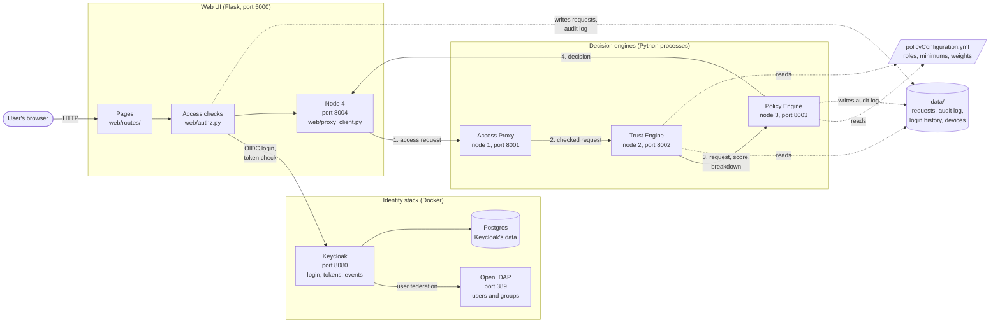
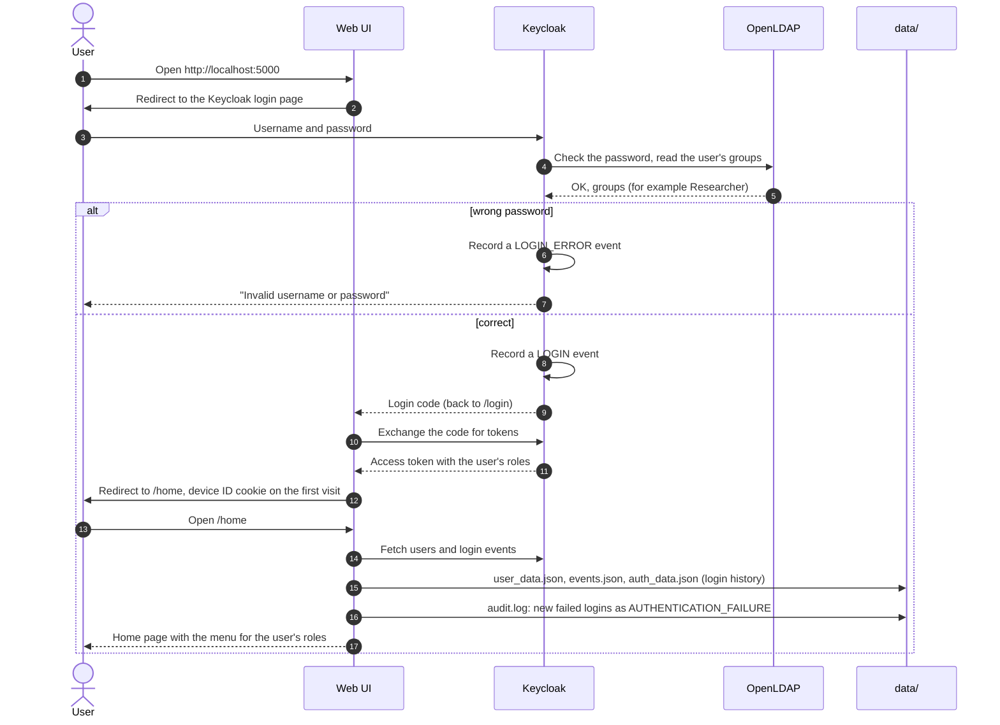
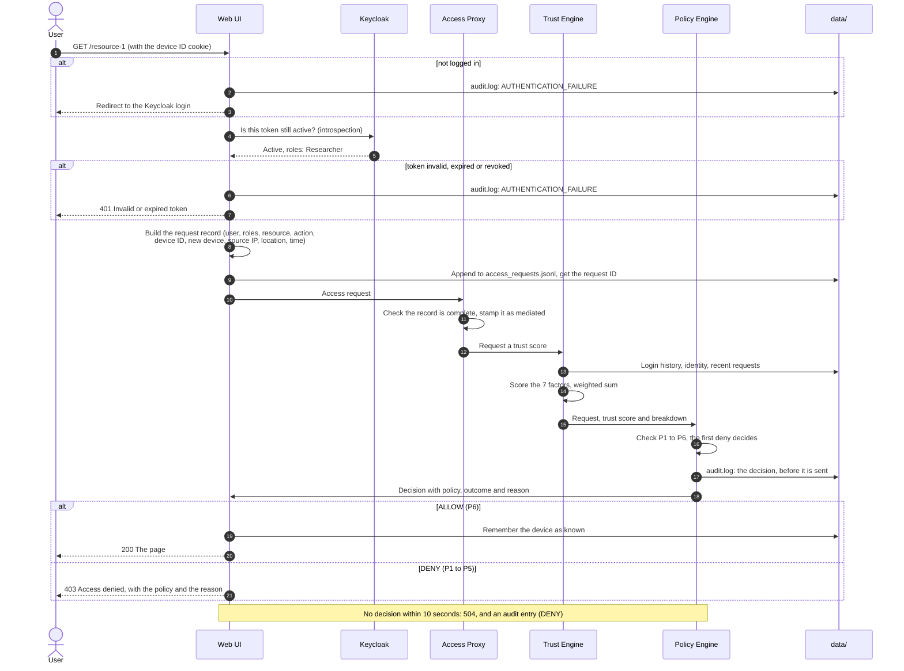
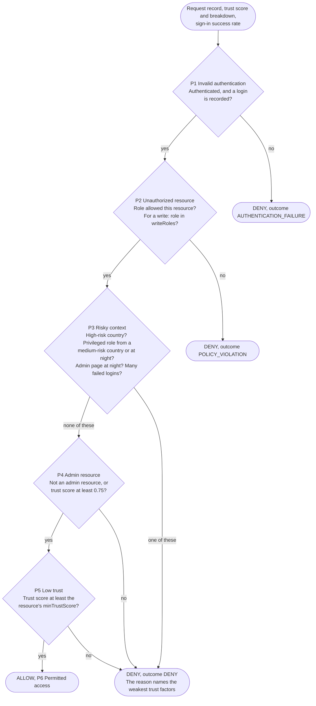
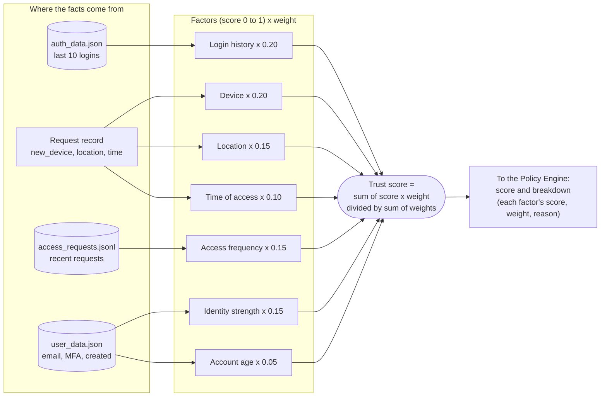
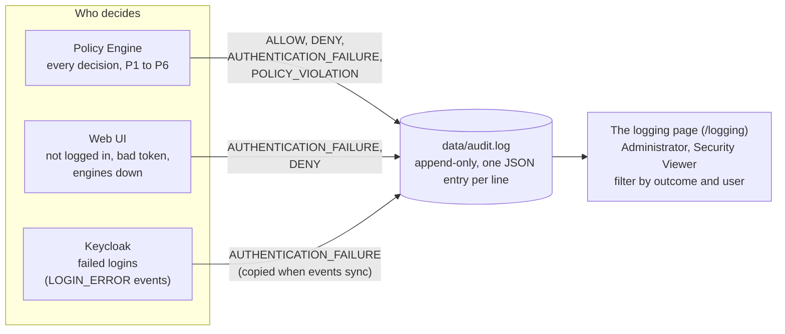
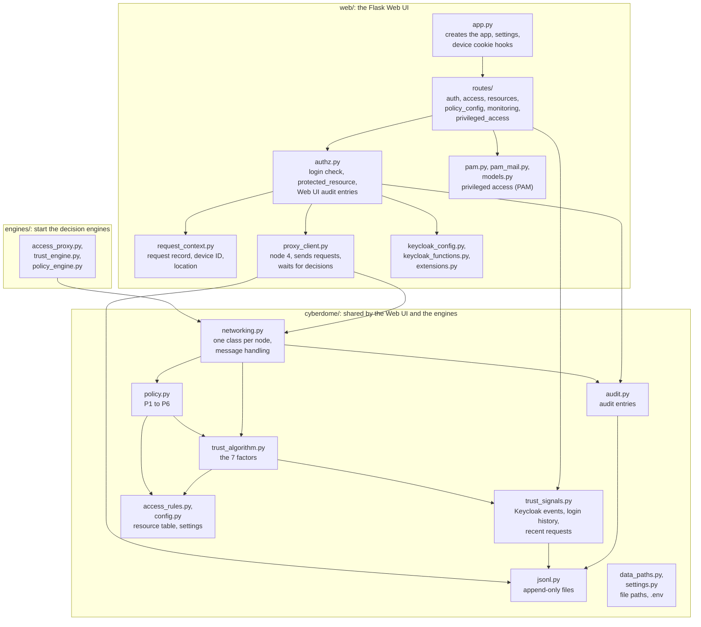

# Diagrams

Pictures of how CyberDome works, to help the team (and readers of the report) find their way in the code. The diagrams are written in [Mermaid](https://mermaid.js.org/), so GitHub and VS Code (with a Markdown preview that supports Mermaid) draw them from the text. To change a diagram, edit the text.

Contents:

1. [Architecture](#1-architecture): the parts of the system and how they connect
2. [Logging in](#2-logging-in): what happens when a user logs in
3. [A protected request](#3-a-protected-request): the full path of one request, from the browser to the resource
4. [Policies](#4-policies): how the Policy Engine decides
5. [Trust score](#5-trust-score): how the Trust Engine scores a request
6. [Audit log](#6-audit-log): where log entries come from
7. [Code map](#7-code-map): which file does what
8. [Data files](#8-data-files): who reads and writes each file

More detail: [how-it-works.md](how-it-works.md), [trust-model.md](trust-model.md), [policies.md](policies.md) and [audit-log.md](audit-log.md).

## 1. Architecture

The user only talks to the Web UI. The Web UI asks Keycloak who the user is, and asks the decision engines whether a request is allowed. The engines are three separate Python processes that send each other messages over local TCP connections (`p2pnetwork`).

Each engine also connects to the other engines at startup, but messages always travel in the order shown: Access Proxy, Trust Engine, Policy Engine, back to the Web UI.

## 2. Logging in

Keycloak owns the login page, so CyberDome never sees the user's password. After the login, the home page copies Keycloak's data that the Trust Engine needs into `data/`.

## 3. A protected request

Every protected page (both resources, policy configuration, logging and PAM approval) takes this path, also when it's opened directly by URL. The page only runs after an "allow".

## 4. Policies

The Policy Engine checks six policies in order. The first one that denies decides, so the reason is always the clearest one. Rules that don't depend on the trust score come first.

The settings (allowed roles, `writeRoles`, `minTrustScore` per resource, `adminMinTrustScore`, `privilegedRoles`, risk lists, night window) are in `policyConfiguration.yml`. See [policies.md](policies.md).

## 5. Trust score

The Trust Engine scores 7 factors between 0 and 1, and adds them up with the weights from `policyConfiguration.yml` (`trustWeights`). Behaviour (login history, device, access frequency) is 55% of the score.

Example: a known device in the daytime from `LOCAL`, all logins successful, verified email, no MFA, a new account gives about 0.90. The same on a new device gives about 0.78. See [trust-model.md](trust-model.md).

## 6. Audit log

Every decision ends up in `data/audit.log`, one JSON entry per line, whoever made it. The `/logging` page shows the newest entries.

Each entry has the task's data model fields (`user`, `role`, `resource`, `action`, `device_id`, `source_ip`, `decision`, `trust_score`, `reason`), plus the policy, who decided, the trust breakdown and the context. See [audit-log.md](audit-log.md).

## 7. Code map

Where to look in the code. Arrows mean "uses".

Tests are in `tests/`: `test_trust.py`, `test_policies.py` and `test_audit.py` need nothing running. `check_access_control.py` needs the identity stack and the engines. The start scripts are in `scripts/`.

## 8. Data files

All runtime data is in `data/` (git-ignored). Settings are in `policyConfiguration.yml`, secrets in `.env`.

| File | Written by | Read by | What's in it |
| --- | --- | --- | --- |
| `data/access_requests.jsonl` | Web UI, for every protected request | Trust Engine (access frequency) | The request records, one per line |
| `data/audit.log` | Policy Engine, Web UI, Keycloak sync | `/logging` page, tests | Every access decision, one per line |
| `data/known_devices.json` | Web UI, after an "allow" | Web UI (`new_device`) | The devices each user was allowed access from |
| `data/events.json` | Home page and `/logging` (from Keycloak) | Event processing, audit sync | Keycloak's login events |
| `data/auth_data.json` | Home page (event processing) | Trust Engine, Policy Engine | Login attempts and the sign-in success rate |
| `data/user_data.json` | Home page (from Keycloak) | Trust Engine | Email verified, MFA, account creation time |
| `data/keycloak_audit_state.json` | Audit sync | Audit sync | The newest Keycloak event already in the audit log |
| `data/privileged_access.db` | PAM pages | PAM pages | Privileged access requests and approvals |
| `policyConfiguration.yml` | Policy page (Policy Administrator) | Trust Engine, Policy Engine, Web UI | Resource table, minimum scores, weights, risk lists, night window |
