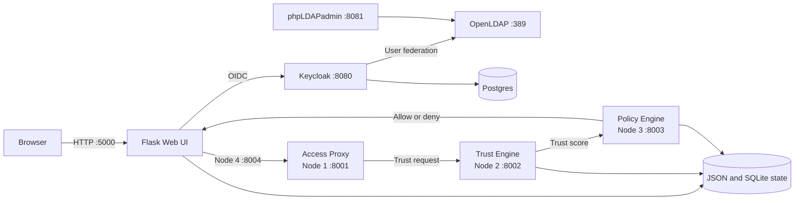

# How CyberDome Works

CyberDome is a local zero-trust access-control prototype. It combines OIDC authentication, LDAP-backed identities, contextual trust scoring, role-based policy thresholds, a peer-to-peer decision pipeline, and a Flask Web UI.

This is a research and demonstration system, not a production security gateway. It uses local development credentials, JSON files for decision data, and unencrypted peer-to-peer connections on localhost.

## Architecture



| Component | Responsibility |
| --- | --- |
| Flask Web UI | Login, resource selection, policy configuration, access logs, and privileged-access workflows |
| Keycloak | OIDC authorization, tokens, application roles, login events, and LDAP federation |
| OpenLDAP | Directory identities; the local seed includes `alice` |
| Postgres | Keycloak persistence |
| Access Proxy | Receives Web UI requests and asks for a trust evaluation |
| Trust Engine | Calculates a score from identity, authentication, account, and request context |
| Policy Engine | Applies role-specific thresholds and records an allow or deny verdict |
| phpLDAPadmin | Browser-based administration for OpenLDAP |

## Authentication Flow

1. A browser requests Flask at `http://localhost:5000`.
2. Flask-OIDC redirects the browser to the `myrealm` realm in Keycloak.
3. Keycloak authenticates a native user such as `demo` or a federated OpenLDAP user such as `alice`.
4. Keycloak redirects the browser to Flask with an authorization code.
5. Flask exchanges the code for tokens and introspects the access token.
6. The home route reads the current client role and Keycloak user/event data.
7. Normalized users are written to `data/user_data.json`, and processed authentication events to `data/auth_data.json`.

The application recognizes the Keycloak client roles `Approver`, `Security Viewer`, and `Policy Administrator`. The seeded `demo` user has the `Approver` role. LDAP authentication for `alice` works, but an application client role must be assigned before using role-dependent Web UI workflows.

## Access-Decision Flow

Every request for a protected resource (both resources, policy configuration, logging and PAM approval) goes through the decision engines before the page runs. Opening a page directly by URL takes the same path.

```
User -> Authentication -> Access Proxy -> Trust Engine -> Policy Engine -> Allow/Deny -> Resource
```

1. The user opens a protected page, for example `/resource-1`.
2. `@protected_resource` (`web/authz.py`) checks the login and asks Keycloak whether the token is still active. Otherwise: login redirect or `401`.
3. The Web UI builds the request record on the server (`web/request_context.py`, see Request Record below): user, roles, resource, action, time, authentication status, source IP and its location, device ID, and device type, OS and browser. It appends the record to `data/access_requests.jsonl` (one record per line) with a new `ID`.
4. The Web UI's node 4 (`web/proxy_client.py`, one node shared by all requests on port `8004`) sends the record to the Access Proxy on port `8001`.
5. The Access Proxy checks the record is complete (ID, user, resource, action, authentication status), stamps it as mediated, and forwards the whole record to the Trust Engine on port `8002`. An incomplete record is rejected with a reason.
6. The Trust Engine scores this request and sends the record, the score and its breakdown to the Policy Engine on port `8003`. If scoring fails, it sends the error instead.
7. The Policy Engine applies the policies P1 to P6 (see Policy Decision below), writes the decision to the audit log `data/audit.log` (with the request, trust score and breakdown, policy, outcome and reason, see Audit Log below), and only then sends it to node 4.
8. The page runs only if the decision is allow. Otherwise the user sees `403` with the policy and the reason. No verdict within 10 seconds gives `504`, and an unreachable Access Proxy gives `503`. Both deny access.

The response carries `X-CyberDome-Request-Id`, `X-CyberDome-Decision`, `X-CyberDome-Decided-By` and `X-CyberDome-Policy` headers, so each page can be traced to its decision.

The access request's `ID` travels through the engines as `request_id`, so each verdict can be matched to its request. Each node is its own class in `cyberdome/networking.py` and only handles the messages it expects. Messages are Python dictionaries wrapped with a sender ID and exchanged by `p2pnetwork` over localhost TCP connections.

## Request Record

The Web UI builds the record in `web/request_context.py`. Every value comes from something the server controls: the checked token, the page, the HTTP connection and the browser's headers. Values in a request body are never used, because the user can change them.

| Field | Source |
| --- | --- |
| `user_id`, `username`, `roles`, `authentication_status` | The token, checked with Keycloak |
| `resource`, `path`, `action` | The page and the HTTP method (`read` for GET, `write` for POST) |
| `access_request_time` | The server clock |
| `source_ip` | The HTTP connection |
| `location` | A lookup of `source_ip`, as a country code. `LOCAL` for localhost and private addresses, `Unknown` if the lookup fails |
| `device_id` | A random ID in the `cyberdome_device_id` cookie (`HttpOnly`, one year), set on the first visit |
| `new_device` | `true` until access was allowed once from this device for this user. Known devices are kept in `data/known_devices.json` |
| `browser`, `device_type`, `device_OS` | The `User-Agent` header |

Why these fields:

- The trust score should use facts about the user's own request. The original record used the Flask server's public IP, location and MAC address, so every user got the same values. These fields are removed.
- A website can't see a visitor's MAC address, because MAC addresses don't cross routers. The device ID cookie takes its place.
- The country code has the same format as the risk lists in `policyConfiguration.yml` (for example `KE`), so location rules can match.
- On localhost the location is always `LOCAL`. Tests for an unusual location fake it inside the test code, not in the app, so a user can't choose their own location.
- A cookie is a weak device identity: the user can delete or copy it. A real deployment would use device certificates or a device management (MDM) check.

## Trust Calculation

The Trust Engine gives each request a score between 0 and 1, from 7 weighted factors. The weights are in `policyConfiguration.yml` (`trustWeights`) and can be changed on the policy page.

| Factor | Weight |
| --- | --- |
| Login history (successful logins out of the last 10 attempts) | 0.20 |
| Device (known or new) | 0.20 |
| Access frequency (requests in the last 5 minutes) | 0.15 |
| Location (country risk lists) | 0.15 |
| Identity strength (verified email, MFA) | 0.15 |
| Time of access (night window) | 0.10 |
| Account age | 0.05 |

The Trust Engine sends the score and a breakdown per factor to the Policy Engine. The scores per factor, the reasons for the weights, the factors we removed and the bugs we fixed are in [trust-model.md](trust-model.md).

## Policy Decision

The Policy Engine checks six named policies in order. The first one that denies decides. If none denies, P6 allows.

| ID | Policy | Denies when | Outcome |
| --- | --- | --- | --- |
| P1 | Invalid authentication | The user is not authenticated, or no login is recorded | `AUTHENTICATION_FAILURE` |
| P2 | Unauthorized resource | None of the user's roles is allowed the resource, or a `write` without a role in `writeRoles` | `POLICY_VIOLATION` |
| P3 | Risky context | High-risk country, medium-risk country or night window for privileged roles, admin resource at night, or too many failed logins | `DENY` |
| P4 | Admin resource | An admin resource and a trust score below `adminMinTrustScore` | `DENY` |
| P5 | Low trust | The trust score is below the resource's `minTrustScore` | `DENY` |
| P6 | Permitted access | (allows) | `ALLOW` |

The minimum trust score is set per resource in the `resources` table of `policyConfiguration.yml`, and can be changed on the policy page. The rules, settings and the reasons behind them are in [policies.md](policies.md).

## Role-Based Access to Pages

Every protected page checks the user before it runs (`web/authz.py`):

1. Not logged in: redirect to the Keycloak login.
2. Token no longer active (introspection): `401`.
3. Everything else is decided by the Policy Engine. None of the user's roles is allowed for the page's resource: `403`, policy P2.

The allowed roles per resource are in the `resources` section of `policyConfiguration.yml`. They can only be changed in the file, not on the policy page. The policy page rewrites this file when it saves, so keys get sorted and comments are dropped.

## Privileged Access Management

The Web UI also has a separate privileged-access workflow:

1. A requester selects approvers and submits a reason and duration.
2. The application generates a resource secret and splits it into shares with threshold secret sharing.
3. Selected approvers receive shares by email and approve or reject the request.
4. Once enough shares are supplied, the application reconstructs and validates the secret.
5. Requests and approver records are stored in `data/privileged_access.db`.

The threshold is currently calculated as 80 percent of the available approvers.

## Audit Log

Every access decision is written to `data/audit.log`, one JSON entry per line, and shown on the `/logging` page (Administrator and Security Viewer):

| Decided by | Events | Outcome |
| --- | --- | --- |
| Policy Engine | Every decision on a protected page | `ALLOW`, `DENY`, `AUTHENTICATION_FAILURE` or `POLICY_VIOLATION` |
| Web UI | Not logged in, invalid or revoked token | `AUTHENTICATION_FAILURE` |
| Web UI | Keycloak or the engines can't be reached, or don't answer in time | `DENY` |
| Keycloak | Failed logins (`LOGIN_ERROR` events) | `AUTHENTICATION_FAILURE` |

Each entry has the task's data model fields (`user`, `role`, `resource`, `action`, `device_id`, `source_ip`, `decision`, `trust_score`, `reason`), plus the policy, who decided, the trust breakdown and the context. The details and the reasons are in [audit-log.md](audit-log.md).

## State And Data

Most JSON and SQLite state files below are created or updated at runtime after their corresponding workflow is used.

| Path | Contents |
| --- | --- |
| `data/access_requests.jsonl` | The access requests from the Web UI, one per line, only appended |
| `data/audit.log` | The audit log: every access decision, one JSON entry per line, only appended (see `audit-log.md`) |
| `data/keycloak_audit_state.json` | The newest Keycloak event already copied into the audit log |
| `data/known_devices.json` | The devices each user was allowed access from |
| `data/access_requests.json`, `data/access_decision.json` | Older formats, no longer written |
| `data/auth_data.json` | Processed authentication events and sign-in values |
| `data/events.json` | Raw events collected from Keycloak |
| `data/user_data.json` | Normalized Keycloak identities and application roles |
| `policyConfiguration.yml` | Thresholds, location groups, and time period |
| `data/privileged_access.db` | PAM requests and approver state |
| Docker named volumes | Keycloak Postgres data and OpenLDAP data/configuration |

## Runtime Topology

| Port | Process |
| --- | --- |
| `389` | OpenLDAP |
| `5000` | Flask Web UI |
| `8001` | Access Proxy, peer node 1 |
| `8002` | Trust Engine, peer node 2 |
| `8003` | Policy Engine, peer node 3 |
| `8004` | Web UI peer node 4, started on the first protected request |
| `8080` | Keycloak under the `/auth` path |
| `8081` | phpLDAPadmin |

`scripts/runAll.sh` starts the Trust Engine, Policy Engine, and Access Proxy in dependency order. It checks ports `8001` through `8003`, monitors its child processes, and stops all three on `Ctrl+C`.

All data paths come from `cyberdome/data_paths.py` and are built from the code's location, so they don't depend on the folder a process starts in. Settings and secrets for the Web UI (Keycloak client secret, Keycloak admin login, Flask session key, optional PAM email account) come from environment variables, read by `cyberdome/settings.py`. It first loads `.env` from the repo root if it exists. `.env` is git-ignored, and `.env.example` lists every variable.

## Identity Bootstrap

`compose.yml` starts Postgres, OpenLDAP, phpLDAPadmin, and Keycloak. The first startup initializes:

- the `myrealm` Keycloak realm;
- the confidential `ZeroTrustPlatform` OIDC client;
- the three application client roles;
- the native `demo` user;
- the OpenLDAP federation provider and attribute mappers; and
- the LDAP `alice` user and `Approver` LDAP group.

Keycloak imports `infra/keycloak/myrealm-realm.json` only when `myrealm` does not already exist. OpenLDAP similarly initializes its seed only with a fresh data volume. To rebuild both from source configuration:

```bash
docker compose down -v
docker compose up -d --build
```

This command destroys all local identity data.

## Prototype Limitations

- Local peer traffic is unauthenticated and unencrypted.
- JSON files are shared mutable state without locking or transactions.
- The device ID is a cookie, so a user can delete or copy it. On localhost the location is always `LOCAL`.
- Trust scoring expects complete identity, authentication, and request records plus a numeric account timestamp.
- The Web UI's secrets come from `.env`, but the identity stack's local passwords are still in `compose.yml` and `infra/` (Postgres, LDAP admin, Keycloak admin, and the seeded users). The `ZeroTrustPlatform` client secret is also in `infra/keycloak/myrealm-realm.json`, and `KEYCLOAK_CLIENT_SECRET` must match it.
- Flask debug mode and Keycloak development mode are enabled.

## Troubleshooting

### Keycloak connection refused

```bash
docker context use colima
docker compose ps -a
docker compose logs --tail=100 keycloak
curl http://localhost:8080/auth/realms/myrealm/.well-known/openid-configuration
```

The discovery request should return JSON and HTTP `200`.

### An engine port is already in use

```bash
lsof -nP -iTCP:8001-8003 -sTCP:LISTEN
```

Stop old engine processes before running `./scripts/runAll.sh` again.

### Login works but evaluation fails

Verify that the user has an application client role and matching records in `data/user_data.json`, `data/auth_data.json`, and `data/access_requests.jsonl`. The current scoring code requires all three records.

## Main Source Files

| Path | Purpose |
| --- | --- |
| `engines/access_proxy.py` | Access Proxy process, node 1 |
| `engines/trust_engine.py` | Trust Engine process, node 2 |
| `engines/policy_engine.py` | Policy Engine process, node 3 |
| `cyberdome/networking.py` | Peer-to-peer nodes: a `Networking` base class plus `AccessProxyNode`, `TrustEngineNode`, `PolicyEngineNode` and `WebUINode` |
| `cyberdome/policy.py` | The policies P1 to P6 (see `policies.md`) |
| `cyberdome/config.py` | Reads `policyConfiguration.yml` |
| `cyberdome/audit.py` | The audit log (see `audit-log.md`) |
| `cyberdome/jsonl.py` | Files with one JSON object per line: append with a lock, read from the end |
| `scripts/` | Launchers: `runAll.sh` for the three engines, `runWebUI.sh` for the Web UI, and one script per engine |
| `tests/` | Manual check scripts: `test.py` prints one user's trust score, `testAP.py` runs a stand-alone Access Proxy |
| `compose.yml` | Local identity and database stack |
| `infra/keycloak/` | Seeded Keycloak realm |
| `infra/openldap/` | OpenLDAP image and seed LDIF |
| `web/app.py` | Creates the Flask app, loads its settings and registers the pages |
| `web/authz.py` | Page checks: `@require_authentication` (login and active token) and `@protected_resource(resource)` (sends the request through the engines) |
| `cyberdome/access_rules.py` | Reads the role-to-resource table from `policyConfiguration.yml` |
| `web/extensions.py` | Shared objects: login (`oidc`), the PAM database (`db`) and the Keycloak clients |
| `web/models.py` | PAM database tables (`AccessRequest`, `Approver`) |
| `web/routes/` | The pages, one blueprint per area: `auth`, `access`, `resources`, `policy_config`, `monitoring`, `privileged_access` |
| `cyberdome/trust_algorithm.py` | Trust-score calculations: 7 factors and their weights (see `trust-model.md`) |
| `cyberdome/data_paths.py` | Locations of the shared data and config files |
| `cyberdome/settings.py` | Settings and secrets from environment variables and `.env` |
| `cyberdome/trust_signals.py` | Event processing and JSON lookups |